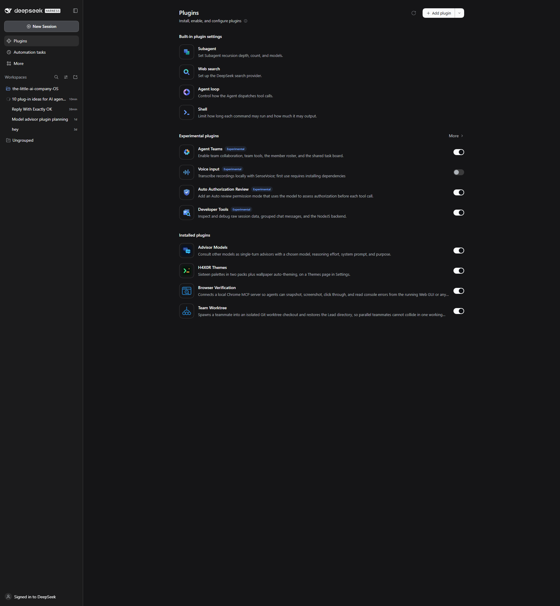
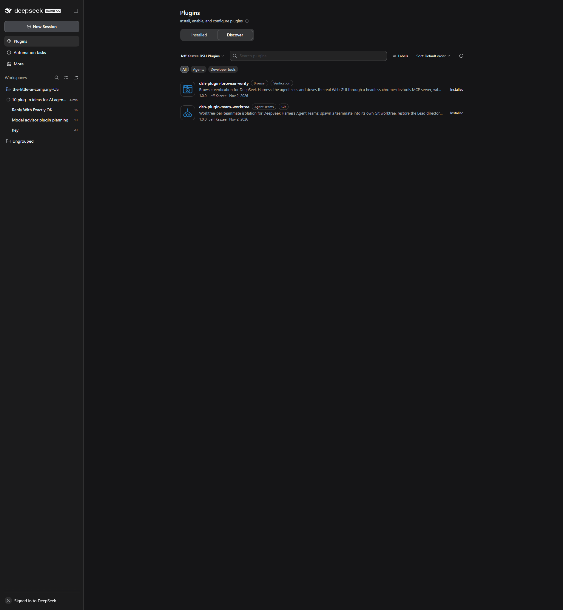

# DSH Plugins by Jeff Kazzee

Plugins for **DeepSeek Harness (DSH)** that give the agent eyes and give agent teams
their own checkout.

| Plugin | What it does | Install |
|---|---|---|
| [browser-verify](browser-verify/) | The agent can see and drive the real Web GUI: snapshots, screenshots, clicks, console errors, plus a one-shot login handoff. | `dsh-plugin-browser-verify` |
| [team-worktree](team-worktree/) | Spawns Agent Teams teammates into isolated Git worktrees with a merge gate, so parallel agents stop colliding in one working tree. | `dsh-plugin-team-worktree` |
| [plugin-lab](plugin-lab/) | The gated loop we build these with: acceptance before mount, receipts, reversible install. | copy the template |



## Install from the plugin market

1. Open **Plugins** in the DSH sidebar.
2. Enable **Custom plugin markets** (Experimental plugins).
3. Open **Discover**, add this index URL:

```
https://raw.githubusercontent.com/Jeff-Kazzee/dsh-plugins/main/index.json
```

4. Install **Browser Verification** or **Team Worktree**.



[Watch the 30 second demo](assets/demo.mp4) (1080x1920, captions baked in, no audio).

## Install from Git directly

```sh
# replace <commit> with the commit from index.json (or any tag)
dsh plugin install "git+https://github.com/Jeff-Kazzee/dsh-plugins.git#<commit>&path:/browser-verify"
dsh plugin install "git+https://github.com/Jeff-Kazzee/dsh-plugins.git#<commit>&path:/team-worktree"
```

Or point the Plugin Manager at the directory after cloning:

```sh
git clone https://github.com/Jeff-Kazzee/dsh-plugins.git
```

Then `plugin_manager` → `install_bundle` with the absolute path of the plugin
directory. Disable the row or uninstall the bundle to roll back; no profile
configuration is overwritten.

## What each plugin unlocks

**Browser verification.** DSH's Desktop window holds a signed session cookie, so an
isolated browser starts unauthenticated. This bundle mounts a headless
`chrome-devtools-mcp` server and a one-shot credential handoff, so the agent can open
the real GUI, take an accessibility snapshot, screenshot it, click through it, and
read console errors. Every plugin change can be verified instead of assumed.

**Team worktree.** Agent Teams teammates share the Lead's working directory. This
tool creates a Git worktree, spawns the teammate inside it, and restores the Lead's
directory atomically. The teammate commits on its own branch and reports a receipt;
the Lead reviews the diff, runs the tests, and merges. Two teammates can touch the
same repository without touching the same files.

**Plugin lab.** The discipline behind both: one capability per plugin, an acceptance
file written before mount, an independent verification channel, and a one-step
rollback. The lab includes the template and the checklist.

## Bonus: multi-provider routes

[docs/multi-provider-routes.md](docs/multi-provider-routes.md) shows how to read
Claude Code and Codex OAuth grants into DSH's `llm-pi-ai` routes, so Claude and GPT
models appear in the model picker. Read the policy caveat there before using a
subscription grant outside its own client.

## Requirements

- DeepSeek Harness `0.2.1-rc.5` or newer in the `0.2.x` line
- Node.js 20+ (bundled with DSH is fine)
- Node and Chrome for browser-verify (`npx` resolves `chrome-devtools-mcp` on first run)
- Git 2.45+ for team-worktree

## Safety

These plugins are local tools. They add MCP tools, one credential-handoff page, and
one Lead-only spawn tool. They do not phone home, collect telemetry, or store
credentials. The browser server is headless and isolated from your normal Chrome
profile. The multi-provider guide is a manual procedure: it copies OAuth grant tokens
you already have into DSH's credential store and leaves a backup.

## License

MIT. See [LICENSE](LICENSE). Built by Jeff Kazzee.
